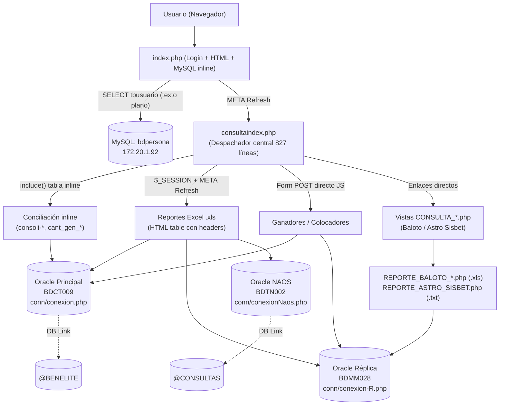

# Ingeniería Inversa y Plan de Modernización — `reporteador-yumundi` → `reporteador_multiempresa`

> **Alcance auditado:** 100% del proyecto legado `reporteador-yumundi/` (49 archivos `.php`, 3 archivos de conexión, scripts JS/HTML y respaldos) y los esqueletos iniciales en `client/` y `server/`.
> **Nota de seguridad:** Todas las credenciales reales y contraseñas en texto plano halladas en el código legado fueron omitidas deliberadamente de este documento.

---

## 1. Arquitectura Actual del Proyecto Legado (`reporteador-yumundi`)

El sistema legado es una aplicación monolítica en **PHP procedural** (desarrollada históricamente sobre NetBeans con Bootstrap 3 y múltiples versiones superpuestas de jQuery: 1.7.1, 1.8.0, 1.12.2, 2.2.1 y 3.1.1).

### 1.1 Fuentes de Datos Identificadas

| Alias lógico | Archivo legado | Motor | Host / Puerto | BD / SID | Usuario | Uso principal |
|---|---|---|---|---|---|---|
| `auth_legacy` | `index.php` | MySQL (`mysqli`) | `172.20.1.92` | `bdpersona` (`tbusuario`) | `cliente` | Autenticación y perfil del usuario |
| `principal` | `conn/conexion.php` | Oracle (`oci8`) | `10.184.39.10:1521` | `BDCT009` | `APLICACIONESYUMBO` | Conciliación Redcolsa, Incentivos 3CF, Ganadores, Devoluciones, Rechazados (+ DB Link `@BENELITE`) |
| `replica` | `conn/conexion-R.php` | Oracle (`oci8`) | `10.167.27.90:1521` | `BDMM028` | `APLICACIONESAPYUMBO` | Baloto, Astro/SISBET, Lotería Virtual, Colocadores Activos, Comisiones, Rollos, Utilidades Giros |
| `naos` | `conn/conexionNaos.php` | Oracle (`oci8`) | `10.195.39.40:1521` | `BDTN002` | `APLICACIONESYUMBO` | Premios Pagados, Recaudos, Lotería Física, Raspes, Máquinas de Ruta (+ DB Link `@CONSULTAS` y esquemas `gamble`/`cerberus`) |

---

## 2. Reglas de Negocio y Constantes Multiempresa Extraídas

En el sistema legado, las constantes de las dos empresas y sus territorios estaban repetidas y quemadas en decenas de consultas SQL:

| Atributo de negocio | MULTIRED (Yumbo) | SERVIRED (Jamundí) |
|---|---|---|
| Código Empresa / Zona (`ZONA`) | `39627` | `39628` |
| Códigos Zona Legados (históricos) | `1197` | `2023` *(y `1077` en huérfano `re/clientepremios.php`)* |
| NIT | `805014543-9` | `805003010-8` |
| Razón Social | `GRUPO EMPRESARIAL MULTIRED S.A` | `GRUPO EMPRESARIAL SERVIRED S.A` |
| Etiqueta Ciudad | `YUMBO` | `JAMUNDI` |
| Código Bodega (`BODORIGEN`/`BODDESTINO`) | `2` (`BODEGA_YUMBO`) | `3` (`BODEGA_JAMUNDI`) |
| Código Archivo SISBET (`ADV_*`) | `020` | `032` |
| Centros de Costo / Municipios | `39629` Yumbo (`76892`), `39630` Vijes (`76869`), `39631` Cumbre (`76377`) | `39632` Jamundí (`76364`) |
| Códigos DANE BENELITE (`APCODANE`) | `76869, 76377, 76892` | `76364` |
| Unidades `registrocajas` legadas | `1198, 1199, 1200, 1201, 1624, 2279, 39629, 39630, 39631` | `2024, 2025, 2026, 2027, 2028, 2029, 2030, 1078, 2244, 2280, 39632` |

### Otras constantes operativas detectadas
- **Tipos de juego (`CODIGO_TIPOJUEGO`)**: `15` = Lotería Virtual; `18` = Astro; `25` = excluido junto a Astro en Chance; `110, 116` (y `104` solo en `cant_gen_yum`) = excluidos de ventas Chance.
- **Lotería Física y Raspes**: `SERVICIO_CODIGO IN (510, 511)` = Lotería Física; `proveedorservicios.requiereclave = 'LF'` y `SERVICIO_CODIGO NOT IN (510, 511)` = Raspes.
- **Comisiones y Giros**: Comisiones excluye `SERVICIO NOT IN (802, 804, 806, 807)` (giros); Utilidades Giros filtra `CO.NIT = '900084777'` y excluye cédula `1086362524`.
- **Papelería / Rollos**: `DAT_DTO_CODIGO = 10` (formularios gastados); serie `'100'` = `500` form/rollo (`BOND`); serie `'200'` = `150` form/rollo (`TERMICO`).
- **Grupos de venta (`GRUPOVENTAS`)**: `929` Punto Fijo, `930` Móvil, `12` Recorrido, `13/931` PDA/Celular, `950` Ganeservicios Fijo, `952/953` Integrante Cajero.
- **Cajeros y Recaudos**: `cerberus.ms_usuario.grupcodi IN (16, 17)`, `TRANS_CODIGO IN (47, 49)`, `VERSION = 0`.
- **Estados de traslado (`TRASLADO.ESTADO`)**: `0` Construcción, `1` Pendiente, `2` Recibido, `3` Confirmado, `4` Rechazado, `5` Cerrado por Devolución.
- **Colocadores Activos**: excluye 14 documentos de prueba/sistema (`1117222333`, `1119444555`, `1118111222`, `11118000111`, `11113002019`, `1113002017`, `1125111222`, `1118002017`, `2001`, `901007388`, `901260918`, `901021901`, `1112475812`, `1234567890`) y re-inclusión de nómina (`grupoplanes_codigo IN (212, 213)` y `plan_tipoventavirtual IN (52, 54, 62, 58, 59, 68)`).

---

## 3. Matriz de Perfiles y Permisos (extraída de `consultaindex.php`)

> **Nota crítica del legado:** En `reporteador-yumundi`, los permisos **solo ocultaban botones HTML** en `consultaindex.php`. Ningún script `REPORTE_*.php` ni `CONSULTA_*.php` validaba permisos en el servidor.

| Perfil (`tbusuario.perfil`) | Empresas habilitadas en selector | Campo Sorteo | Módulos / Reportes visibles en menú |
|---|---|---|---|
| `ADMIN` | MULTIRED, SERVIRED | No | Ganadores, Rechazados, Consultar Devoluciones, Plano Devoluciones, Vendedores Baloto, Usuarios Astro SISBET, Lot-Virtual, Concil-Redco (5), Concil-Incentivos (3CF), Colocadores, Reporte Recaudos *(en la versión nueva tiene acceso completo administrable)* |
| `APLICACIONES` | MULTIRED, SERVIRED | No | Rechazados, Usuarios Astro SISBET, Colocadores, Premios Pagados, Comisiones, Reporte Recaudos, Utilidades Giros, Reportes LF y Raspes (5), Rollos x Sucursal BNET, Máquinas Ruta (2) |
| `CUMPLIMIENTO` | MULTIRED, SERVIRED | No | Ganadores, Colocadores |
| `CONTABILIDAD-MULTIRED` | MULTIRED, SERVIRED | No | Concil-Redco (5), Concil-Incentivos (3CF) |
| `CONTABILIDAD-SERVIRED` | MULTIRED, SERVIRED | No | Concil-Redco (5), Concil-Incentivos (3CF), Máquinas Ruta (2) |
| `COMERCIAL-MULTIRED` | Solo MULTIRED (`39627`) | Sí | Rechazados, Consultar Devoluciones, Plano Devoluciones, Existencia Rollos, Reportes LF y Raspes (5) |
| `COMERCIAL-SERVIRED` | Solo SERVIRED (`39628`) | Sí | Rechazados, Consultar Devoluciones, Plano Devoluciones, Colocadores, Existencia Rollos, Reportes LF y Raspes (5) |
| `AUDITORIA` | MULTIRED, SERVIRED | No | Colocadores |
| `AUDITORIA-OPERATIVA` | MULTIRED, SERVIRED | No | Rechazados |
| `AUDITORIA-SERVIRED` | MULTIRED, SERVIRED | No | Comisiones, Utilidades Giros, Máquinas Ruta (2) |
| `ADMINISTRACION_MULTIRED` | Solo MULTIRED (`39627`) | No | Existencia Rollos |
| `ADMINISTRACION_SERVIRED` | MULTIRED, SERVIRED | No | Existencia Rollos, Rollos x Sucursal BNET |
| `CONTEO_MULTIRED` | Solo MULTIRED (`39627`) | No | Premios Pagados, Reporte Recaudos |
| `CONTEO_SERVIRED` | Solo SERVIRED (`39628`) | No | Premios Pagados, Reporte Recaudos |
| `AUXILIAR OFICINA` | MULTIRED, SERVIRED | No | Lot-Virtual |

---

## 4. Catálogo Completo de los 27 Reportes Activos Consolidados

Los 31 scripts activos del legado se consolidan en **27 definiciones de reporte** (parametrizando los pares duplicados Yumbo/Jamundí y Multired/Servired):

| ID | Slug en nuevo sistema | Módulo | Script(s) legado(s) | Oracle | Parámetros | Salida | Tablas / Vistas / Funciones clave |
|---|---|---|---|---|---|---|---|
| R01 | `ganadores-diario` | Ganadores | `REPORTE_TERCEROS_GANADORES_DIARIO_YUMBO.php`, `..._JAMUNDI.php` | `principal` | `date_range` + empresa | `xlsx` (12 cols) | `premioformularios`, `premioformularios2`, `premiospersona`, `personas`, `formularios`, `TIPOJUEGOS`, `GAMBLE.PAGOPREMIORASPEFISREPL` |
| R02 | `consolidado-generados` | Concil-Redco | `consoli-gen.php` | `principal` | `date_range` | `table_and_xlsx` (5 cols) | `VENTASPREMIOSDIAS`, `productos`, `premioformularios`, `premioformularios2`, `FORMULARIOS` |
| R03 | `consolidado-pagados` | Concil-Redco | `consoli-pag.php` | `principal` | `date_range` | `table_and_xlsx` (5 cols) | `premiospersona`, `premioformularios`, `premioformularios2`, `formularios`, `detalleformularios` |
| R04 | `cantidad-generados` | Concil-Redco | `cant_gen_yum.php`, `cant_gen_jam.php` | `principal` | `date_range` + empresa | `table_and_xlsx` (7 cols) | `BN_APUESTAS@BENELITE`, `HIST_APUESTAS_AGO2025@BENELITE`, `formularios`, `hist_formularios`, `registrocajas`, `CONSOLIDADOVENTASERVICIOS` |
| R05 | `detalle-premios-generados` | Concil-Redco | `REPORTE_DETALLE_PREMIOS_GEN.php` | `principal` | `date_range` + empresa | `xlsx` (12 cols) | `premioformularios`, `premioformularios2`, `FORMULARIOS`, `gambledbv10.restoubicacionneg3` |
| R06 | `detalle-premios-pagados` | Concil-Redco | `REPORTE_DETALLE_PREMIOS_PAG.php` | `principal` | `date_range` + empresa | `xlsx` (20 cols) | `PREMIOSPERSONA`, `FORMULARIOS`, `PREMIOFORMULARIOS`, `PREMIOFORMULARIOS2`, `PERSONAS`, `TIPOJUEGOS`, `gambledbv10.restoubicacionneg3` |
| R07 | `detalle-incentivos-3cf` | Concil-Incentivos | `REPORTE_DETALLE_PREMIOS-INCENTIVOS_3CF.php` | `principal` | `date_range` + empresa | `xlsx` (6 cols) | `PREMIOFORMULARIOS2`, `PREMIOFORMULARIOS`, `DETALLEFORMULARIOS`, `FORMULARIOS` |
| R08 | `loteria-virtual-premios` | Lot-Virtual | `REPORTE_PREMIOS_LOTERIA_JAMUNDI.php`, `..._YUMBO.php` | `replica` | `date_range` + empresa | `xlsx` (8 cols) | `premiospersonaproveedor`, `proveedores`, `CONTRATOPERSONAS`, `hist_detalleformularios` |
| R09 | `consulta-devoluciones` | Devoluciones | `CONSULTA_DEVOLUCIONES.php` | `principal` | `single_date` + empresa | `xlsx` (7 cols) | `traslado`, `detalletraslado`, `kardexbodega`, `kardexcantidad`, `productosinventario`, `personas` |
| R10 | `plano-devoluciones` | Devoluciones | `PLANO_DEVOLUCIONES.php` | `principal` | `single_date_sorteo` + empresa | `xlsx` (9 cols) | Mismas 6 tablas (`ESTADO = 3` + `ROW_NUMBER` consecutivo) |
| R11 | `rechazados` | Rechazados | `REPORTE_RECHAZADOS.php` | `principal` | `date_range` + empresa | `xlsx` (13 cols) | `TRASLADO`, `KARDEXBODEGA`, `KARDEXCANTIDAD`, `TIPOTRASLADO`, `PRODUCTOSINVENTARIO`, `BODEGA` |
| R12 | `vendedores-baloto` | Baloto | `REPORTE_BALOTO_MULTIRED.php`, `..._SERVIRED.php` | `replica` | `document_list` + empresa | `xlsx` (18 cols) | `personas`, `HORARIOPERSONAS`, `CONTRATOSVENTA`, `GAMBLEDBV10_2.NOMBRETERRITORIOS1` |
| R13 | `astro-sisbet-usuarios` | Astro SISBET | `REPORTE_ASTRO_SISBET.php` | `replica` | `document_list` (+ empresa opcional) | `txt` (plano `\|`, CRLF) | `CONTRATOSVENTA`, `personas` |
| R14 | `colocadores-activos` | Colocadores | `REPORTE_COLOCADORES_ACTIV.php` | `replica` | `company_only` | `xlsx` (5 cols) | `CONTRATOSVENTA`, `PERSONAS`, `GRUPOPLANES`, `GAMBLEDBV10.RESTOUBICACIONNEG3` |
| R15 | `comisiones` | Comisiones | `REPORTE_COMISIONES.php` | `replica` | `date_range` + empresa | `xlsx` (8 cols) | `v_totalventasnegocio`, `PERSONAS`, `GAMBLEDBV10.RESTOUBICACIONNEG3` |
| R16 | `utilidades-giros` | Utilidades Giros | `REPORTE_UTILIDADES_GIROS.php` | `replica` | `date_range` + empresa | `xlsx` (3 cols) | `consolidadoventaservicios`, `PERSONAS` |
| R17 | `existencia-rollos` | Rollos | `REPORTE_EXISTENCIA_ROLLOS.php` | `replica` | `date_range` + empresa | `xlsx` (8 cols) | `formularios`, `hist_formularios`, `formulariopersonas`, `contratosventa`, `personas` |
| R18 | `rollos-sucursal-bnet` | Rollos BNET | `REPORTE_ROLLOS_X_SUCURSAL_BNET.php` | `replica` | `date_range` + empresa | `xlsx` (5 cols) | `formularios`, `hist_formularios`, `info_puntosventa_cem` |
| R19 | `premios-pagados` | Premios Pagados | `REPORTE_PREMIOS_PAGADOS.php` | `naos` | `date_range` + empresa | `xlsx` (9 cols) | `premiospersonaproveedor`, `premiospersonaproveedor@CONSULTAS`, `PERSONAS`, `UBICACIONNEGOCIOS`, `cerberus.ms_usuario` |
| R20 | `recaudos` | Recaudos | `REPORTE_RECAUDOS.php` | `naos` | `date_range` + empresa | `xlsx` (8 cols) | `cajasdiarias@consultas`, `personas`, `cerberus.ms_usuario` |
| R21 | `inventario-raspe-bodega` | LF y Raspes | `REPORTE_RASPE_BODEGA.php` | `naos` | `company_only` | `xlsx` (8 cols) | Vista `GAMBLE.INVENTARIO_PRINCIPAL_RSP_V` |
| R22 | `inventario-raspe-vendedor` | LF y Raspes | `inventario_raspe_vendedor.php` | `naos` | `company_only` | `xlsx` (6 cols) | Vista `GAMBLE.INVENTARIO_BODEGA_RSP_V` |
| R23 | `redencion-boletas` | LF y Raspes | `redencion_boletas.php` | `naos` | `date_range` + empresa | `xlsx` (5 cols) | `NUMERACIONCLIENTERIFA`, `personas`, `contratopersonas` |
| R24 | `ventas-lf-colocador` | LF y Raspes | `reporte_lf_colocador.php` | `naos` | `date_range` + empresa | `xlsx` (9 cols) | `GAMBLE.detallevtasotrosproductos`, `personas`, `proveedores` |
| R25 | `ventas-raspe-colocador` | LF y Raspes | `reporte_raspe_colocador.php` | `naos` | `date_range` + empresa | `xlsx` (9 cols) | `GAMBLE.detallevtasotrosproductos`, `personas`, `proveedores`, `proveedorservicios` |
| R26 | `recaudos-maquinas-ruta` | Máquinas Ruta | `REPORTE_RECAUDOS_MAQUINAS_RUTA.php` | `naos` | `date_range` + empresa | `xlsx` (10 cols) | `cajasdiarias@consultas`, `personas`, `cerberus.ms_usuario`, `gamble.ubicacionmaquinas` |
| R27 | `premios-maquinas-ruta` | Máquinas Ruta | `REPORTE_PREMIOS_MAQUINAS_RUTA.php` | `naos` | `date_range` + empresa | `xlsx` (6 cols) | `gamble.autorizacionespdv`, `gamble.personas` |

---

## 5. Archivos Huérfanos, Duplicados y Obsoletos (20 archivos descartados)

- **Duplicados / reemplazos muertos**: `Detalles-gen.php` (copia exacta de `consoli-pag.php`), `indexold.php`, `REPORTE_COLOCADORES_ACTIV.php.bkp.03102023`, `REPORTE_COMISION.php` (SQL roto `ORA-01008` + headers de lotería), `REPORTE_COMISION_SERVIRED.php` (filtra `39627` y descarga `ASTRO_SERVIRED.xls`), `CONSULTA_ASTRO.php`, `REPORTE_COLOCADORES_ASTRO.php` (ruta rota `../conn/` y colisión de columnas).
- **Huérfanos / enlaces rotos**: `CONSULTA_COMISIONES.php` (apunta a `REPORTE_ASTRO_SERVIRED.php` inexistente), `CONSULTA_COMISIONES_SERVIRED.php`, `CONSULTA_ASTRO_MULTIRED.php`, `REPORTE_ASTRO_MULTIRED.php`, `re/apertura.php`, `re/clientepremios.php`, `prueba1.html`, `prueba.*`, `js/code.js`, `js/metodos.js` (vacío), `js/valida_login.js`, `js/valida_registro.js`, más referencias rotas en `consultaindex.php` a `calendario.php` y `vtatotalservicios.php`.
- **DDL peligroso en webroot**: `crear_indices_lotvirtual.php` (ejecuta 5 `CREATE INDEX` sin autenticación; queda excluido de la aplicación web).

---

## 6. Vulnerabilidades Críticas y Bugs Heredados (B1–B12)

### Vulnerabilidades de Seguridad Erradicadas en la Nueva Versión
1. **Cero autenticación/RBAC en reportes**: todos los `REPORTE_*.php` eran invocables directamente sin sesión ni control de perfil.
2. **Inyección SQL generalizada**: ~25 scripts concatenaban variables directamente en Oracle SQL sin bind variables.
3. **Bug en guarda de sesión**: `if ($varsesion == null || $varsesion = '')` asignaba `''` en vez de comparar.
4. **Credenciales quemadas y contraseñas en texto plano** (`conn/*.php`, `index.php`, `tbusuario`).
5. **XSS reflejado** en `indexold.php` y **Header Injection** en `Content-Disposition`.

### Bugs Funcionales Corregidos al Migrar
- **B1 (`redencion_boletas.php`)**: Se reactivó `AND cp.UBCNTRTRIO_CODIGO_COMPUESTO_DE = :empresa` evitando fuga entre empresas y error `ORA-01036`.
- **B2 (`REPORTE_RASPE_BODEGA.php`, `inventario_raspe_vendedor.php`)**: Se eliminaron los binds sobrantes `:fecha1`/`:fecha2` que provocaban `ORA-01036`.
- **B3 (`REPORTE_TERCEROS_GANADORES_DIARIO_*.php`)**: Se normalizan fechas ISO `YYYY-MM-DD` → `DD/MM/YYYY` con `TO_DATE(:fecha, 'DD/MM/YYYY')`.
- **B4 (`PLANO_DEVOLUCIONES.php`)**: Se corrigió `rn 51..99` para generar `00201..00249` (`LPAD(rn - 50, 2, '0')`) y se agregó `ELSE` explícito para `rn >= 200`.
- **B5 (`cant_gen_jam.php`, `cant_gen_yum.php`)**: Se corrigió el espacio faltante `17 AND`, se unificaron filtros parametrizados por empresa y se hizo configurable la tabla histórica `@BENELITE` vía variable de entorno (`ORACLE_BENELITE_HIST_TABLE`).
- **B6 (`REPORTE_PREMIOS_LOTERIA_YUMBO/JAMUNDI.php`)**: Se unificó en un solo reporte filtrado estrictamente por `:empresa` con máscara `'DD/MM/YYYY'`.
- **B7 (`REPORTE_RECAUDOS.php`, `REPORTE_RECAUDOS_MAQUINAS_RUTA.php`)**: Se conserva la lógica `SUBSTR` del legado con binds seguros.
- **B8 (`REPORTE_BALOTO_SERVIRED.php`)**: Se unificó con Multired corrigiendo `CODANE_MUNICIPIO` sobre `HR.UBCNTRTRIO_CODIGO_COMPUESTO_DE`.
- **B9 (`REPORTE_RECHAZADOS.php`)**: Se agregó `TRUNC(t.fecharegistra)` en el `BETWEEN` para no excluir traslados del último día después de las `00:00:00`.
- **B10 (`REPORTE_DETALLE_PREMIOS-INCENTIVOS_3CF.php`)**: Se corrigió el nombre de archivo (`INCENTIVOS3CF`) y se parametrizaron las fechas y zona.
- **B11 (`REPORTE_ASTRO_SISBET.php`)**: Se permite filtrar por empresa opcional además de lista de documentos, conservando el formato exacto `.txt` CRLF ISO-8859-1 sin BOM.
- **B12 (Todos los `.xls`)**: Se reemplaza el HTML falso por archivos `.xlsx` nativos generados con `ExcelJS` y nombres sanitizados sin `/` ni espacios finales.

---

## 7. Arquitectura Objetivo (`server/` + `client/`)

- **Backend (`server/`)**: Express 5 + TypeScript estricto + Programación Orientada a Objetos (`EnvironmentConfig`, `AppError`, `SequelizeDatabase`, `OraclePoolManager`, repositorios, servicios, controladores, `BaseReport` con Template Method para los 27 reportes, `ReportRegistry`, `ExcelReportExporter`, `SisbetTxtExporter`, middlewares `AuthMiddleware`, `RbacMiddleware`, `ErrorHandlerMiddleware`).
- **Base de datos propia (Sequelize)**: `companies`, `roles`, `users`, `reports`, `role_reports`, `role_companies` con `SeedRunner` idempotente.
- **Frontend (`client/`)**: Astro 7 + React + Tailwind CSS 4 + Axios en TypeScript con capa de servicios OOP (`HttpClient`, `AuthApiService`, `CatalogApiService`, `ReportApiService`, `ServiceContainer`) y componentes TSX modulares (`LoginForm`, `DashboardApp`, `Sidebar`, `HeaderBar`, `ReportFilterPanel`, `ReportPreviewTable`).
